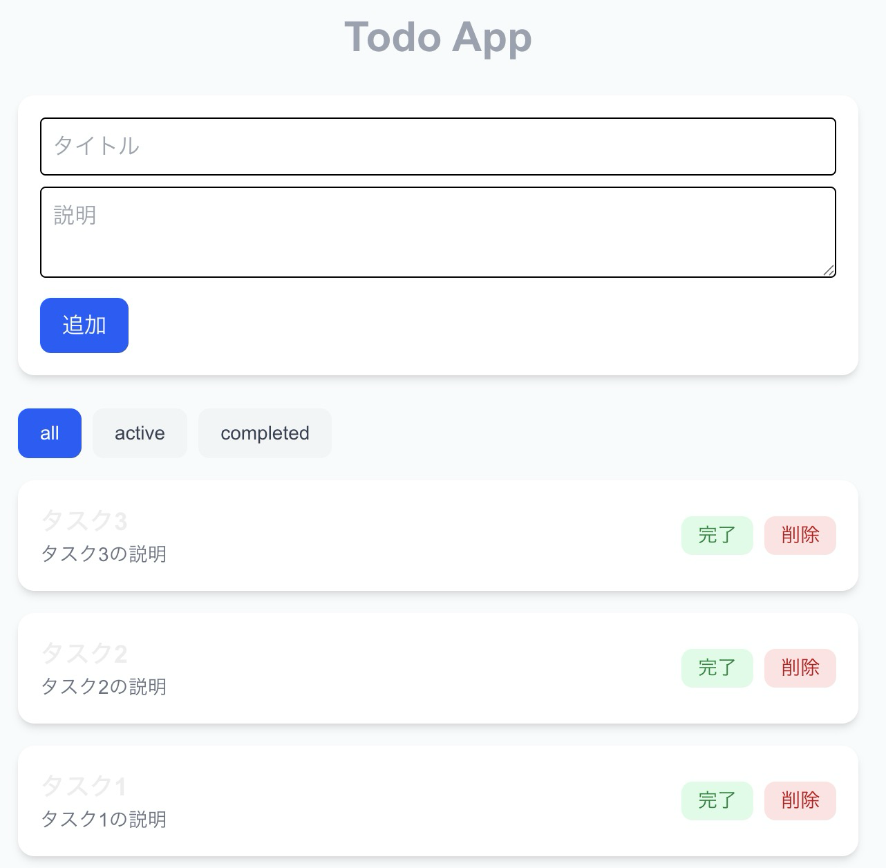

# Todo App

A full-stack Todo management application built with Next.js, Drizzle ORM, and a relational database.



---

## Tech Stack

- Next.js (App Router)
- TypeScript
- Drizzle ORM
- SQLite (local development)
- MySQL (production)
- Tailwind CSS

---

## Features

- List all todos
- View todo details
- Create new todos
- Update existing todos
- Delete todos
- Filter by status (all / active / completed)

---

## Environment Configuration

Create a `.env.local` file for local development:


DB_TYPE=sqlite


For production (example):


```
DB_TYPE=mysql
DB_HOST=localhost
DB_USER=root
DB_PASS=password
DB_NAME=todo_app
```

---

## Production (MySQL)

### 1. Configure environment variables

Set the following variables:

- DB_TYPE=mysql
- DB_HOST
- DB_USER
- DB_PASS
- DB_NAME

### 2. Generate migrations


npx drizzle-kit generate --config=drizzle.mysql.config.ts


### 3. Apply migrations


npx drizzle-kit push --config=drizzle.mysql.config.ts


---

## Database Strategy

This project uses a single schema definition with conditional column configuration depending on the database dialect.

- SQLite is used for local speed and simplicity.
- MySQL is used for production consistency and scalability.

Separate drizzle config files are provided for each dialect.

---

## API Endpoints

### GET /api/todos
Returns all todos.

### POST /api/todos
Creates a new todo.

### GET /api/todos/:id
Returns a specific todo.

### PUT /api/todos/:id
Updates a todo.

### DELETE /api/todos/:id
Deletes a todo.

